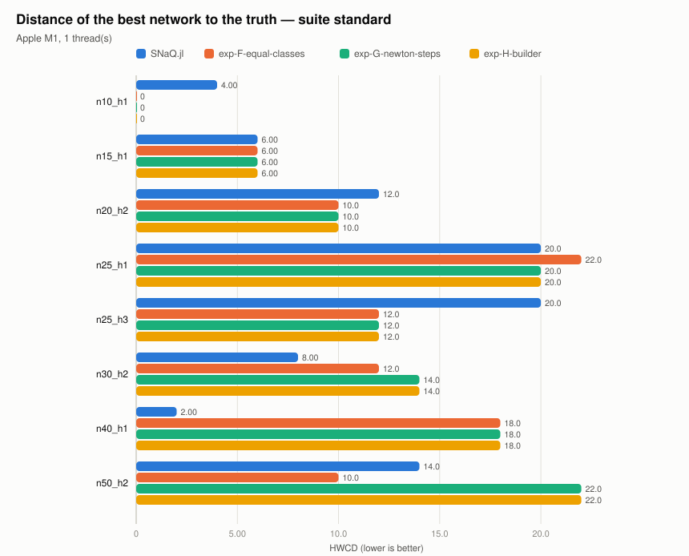
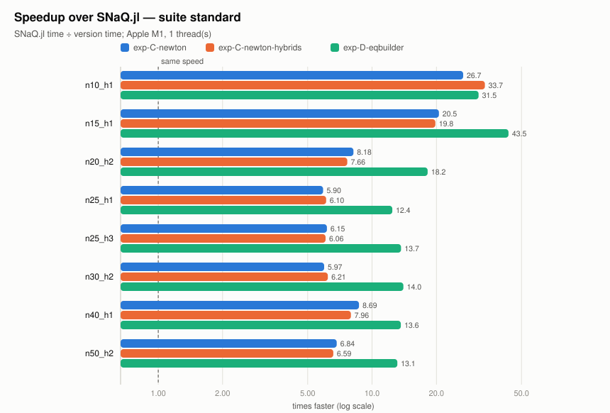
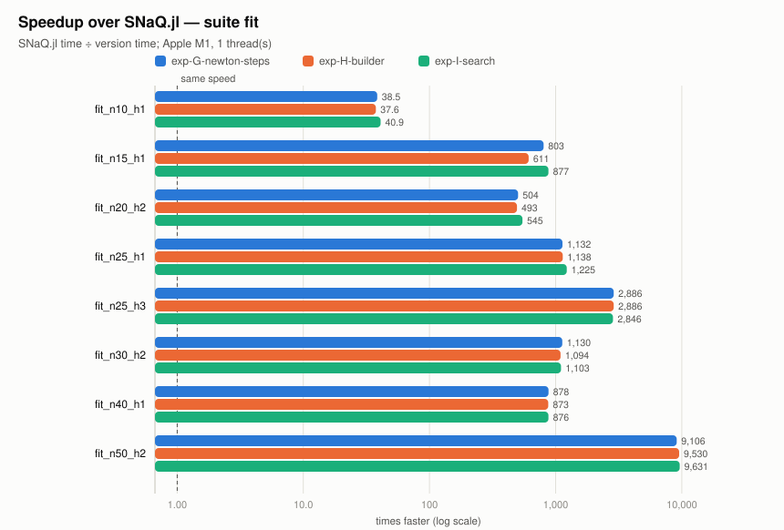
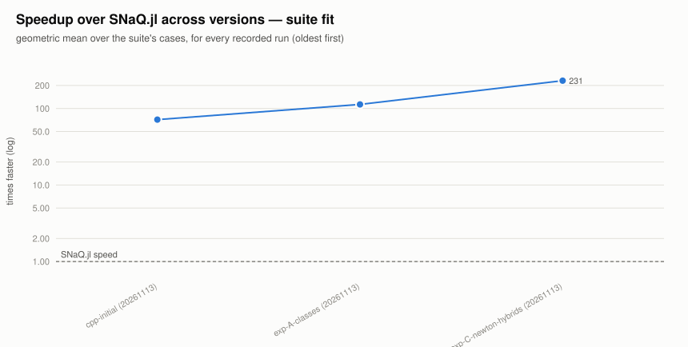

# SNaQ++ benchmark report

Generated 2026-11-16T10:44:09-06:00 by `benchmarks/bench.py report` from `benchmarks/history/results.jsonl`. Baseline: **SNaQ.jl**.

Time is the wall time of the whole `snaq` process for C++. For SNaQ.jl it is the time to build the DataCF plus the `snaq!` call, after a warm-up call, so Julia's start-up and compilation are not included. Peak memory is the peak resident set size of the process; for SNaQ.jl it includes the Julia runtime and loaded packages (see `base_rss_mb` in the history). HWCD is the hardwired cluster distance between the best network and the true network (0: same topology). The score on all quartets is the SNaQ score of the best network recomputed by `snaqpp_eval` on the observed CFs of all quartets, which makes runs that used `propQuartets` < 1 comparable. "Refitted to all quartets" is the score of the best network's topology after its parameters are fitted to all quartets, as is done for the true network: it compares topologies, whatever quartets the reported parameters were estimated from. After `bench.py rescore`, HWCD and the scores on all quartets of every version come from the same `snaqpp_eval`.

## Suite `standard`

End-to-end snaq runs on simulated data from 10 to 50 taxa and 1 to 3 reticulations, 100 runs each. Each case uses about 1000 quartets: propQuartets = propQuartetsFinal = min(1, 1000 / binomial(ntaxa, 4)). Cases with 20 or more taxa use --lazy (observed CFs computed on demand).

Latest run of each version: **SNaQ.jl**: run `20261113T141603_SNaQ.jl`, **v0.1.0**: run `20261113T211412_exp-I-search`.

| case | version | time (s) | peak MB | best score | median run score | score on all quartets | refitted to all quartets | truth score on all quartets | HWCD | hybrids |
|---|---|---|---|---|---|---|---|---|---|---|
| n10_h1 | SNaQ.jl | 24.9132 | 1143.64 | -0.223569 | -0.270387 | -0.233167 | -0.226623 | -0.22524 | 4 | 1 |
| n10_h1 | v0.1.0 | 0.328821 | 9.125 | -0.22524 | -0.226623 | -0.22524 | -0.22524 | -0.22524 | 0 | 1 |
| n15_h1 | SNaQ.jl | 208.937 | 1090.34 | -1.43115 | -3.4746 | -1.98535 | -1.9832 | -2.20124 | 6 | 1 |
| n15_h1 | v0.1.0 | 2.82642 | 11.125 | -1.40214 | -2.45341 | -1.98408 | -1.9832 | -2.20124 | 6 | 1 |
| n20_h2 | SNaQ.jl | 180.818 | 1081.59 | -1.21354 | -7.81406 | -6.37721 | -6.32935 | -6.55637 | 12 | 2 |
| n20_h2 | v0.1.0 | 5.49344 | 15.9375 | -1.28569 | -1.33078 | -6.44092 | -6.40418 | -6.55637 | 10 | 2 |
| n25_h1 | SNaQ.jl | 186.532 | 1184.95 | -1.38173 | -1.56734 | -19.4624 | -19.2281 | -20.1041 | 20 | 1 |
| n25_h1 | v0.1.0 | 8.33526 | 15.7969 | -1.4087 | -1.50859 | -18.3992 | -18.2207 | -20.1041 | 22 | 1 |
| n25_h3 | SNaQ.jl | 1166.13 | 968.203 | -1.57573 | -4.62509 | -21.6193 | -21.2298 | -20.1142 | 20 | 3 |
| n25_h3 | v0.1.0 | 23.2395 | 19.375 | -1.62543 | -3.25612 | -20.1215 | -19.9218 | -20.1142 | 10 | 3 |
| n30_h2 | SNaQ.jl | 312.185 | 966.828 | -1.64993 | -2.28227 | -49.1109 | -48.5461 | -48.9468 | 8 | 2 |
| n30_h2 | v0.1.0 | 10.9471 | 17.4531 | -1.66044 | -1.8097 | -47.2671 | -46.7729 | -48.9468 | 16 | 2 |
| n40_h1 | SNaQ.jl | 210.55 | 1209.11 | -0.826667 | -1.09699 | -83.5046 | -82.0908 | -81.2316 | 2 | 1 |
| n40_h1 | v0.1.0 | 9.10561 | 36.5781 | -0.861732 | -1.18141 | -80.3936 | -79.3912 | -81.2316 | 20 | 1 |
| n50_h2 | SNaQ.jl | 389.614 | 1131.92 | -1.15819 | -18.212 | -266.663 | -256.563 | -197.667 | 14 | 2 |
| n50_h2 | v0.1.0 | 14.4013 | 40.3438 | -0.951781 | -7.90207 | -216.494 | -208.021 | -197.667 | 22 | 2 |

## Suite `fit`

Numerical parameter optimization of a fixed network (the true network) on the observed CFs of all quartets: fitnumericalparameters! with maxeval = 1000.

Latest run of each version: **SNaQ.jl**: run `20261113T150153_SNaQ.jl`, **v0.1.0**: run `20261113T212120_exp-I-search`.

| case | version | fit (s) | equations (s) | peak MB | score | quartets | parameters |
|---|---|---|---|---|---|---|---|
| fit_n10_h1 | SNaQ.jl | 0.00596933 | 0.00514454 | 692.875 | -0.22524 | 210 | 11 |
| fit_n10_h1 | v0.1.0 | 0.000145792 | 4.6417e-05 | 5.875 | -0.22524 | 210 | 11 |
| fit_n15_h1 | SNaQ.jl | 0.0775856 | 0.0265386 | 715.984 | -2.20124 | 1365 | 16 |
| fit_n15_h1 | v0.1.0 | 8.84591e-05 | 0.000138916 | 6.42188 | -2.20124 | 1365 | 16 |
| fit_n20_h2 | SNaQ.jl | 0.290687 | 0.0717673 | 749.812 | -6.55637 | 4845 | 23 |
| fit_n20_h2 | v0.1.0 | 0.000533 | 0.000476667 | 10.1875 | -6.55637 | 4845 | 23 |
| fit_n25_h1 | SNaQ.jl | 0.776733 | 0.154207 | 711.922 | -20.1041 | 12650 | 24 |
| fit_n25_h1 | v0.1.0 | 0.000633958 | 0.000787584 | 10.9375 | -20.1041 | 12650 | 24 |
| fit_n25_h3 | SNaQ.jl | 4.43912 | 1.21888 | 859.797 | -27.5921 | 12650 | 32 |
| fit_n25_h3 | v0.1.0 | 0.00155954 | 0.00136962 | 11.7969 | -20.1142 | 12650 | 32 |
| fit_n30_h2 | SNaQ.jl | 1.05106 | 0.51477 | 924.594 | -48.9468 | 27405 | 31 |
| fit_n30_h2 | v0.1.0 | 0.000953166 | 0.00111633 | 11.4375 | -48.9468 | 27405 | 31 |
| fit_n40_h1 | SNaQ.jl | 1.918 | 1.18424 | 1056.75 | -81.2316 | 91390 | 39 |
| fit_n40_h1 | v0.1.0 | 0.00218937 | 0.00303583 | 35.4844 | -81.2316 | 91390 | 39 |
| fit_n50_h2 | SNaQ.jl | 27.366 | 8.6391 | 1184.75 | -197.667 | 230300 | 53 |
| fit_n50_h2 | v0.1.0 | 0.00284158 | 0.00765408 | 45.8438 | -197.667 | 230300 | 53 |

