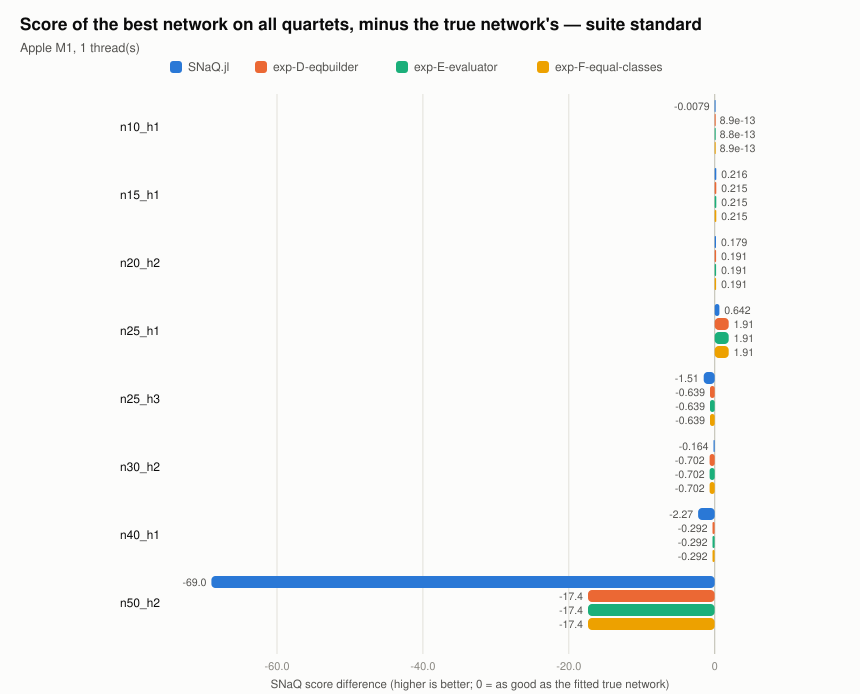
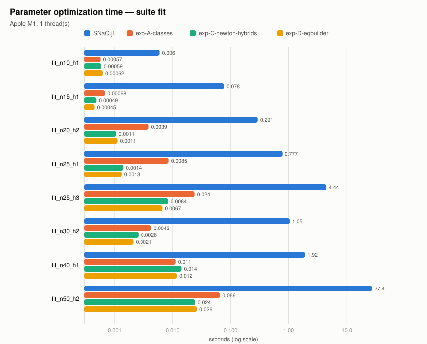
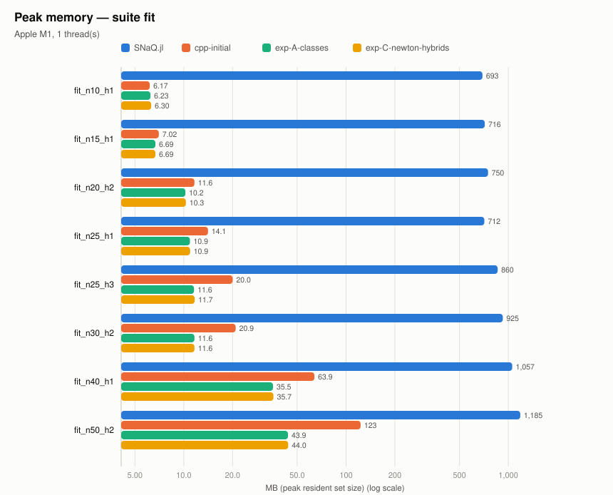

# CSNaQ benchmark report

Generated 2026-11-13T17:45:19-06:00 by `benchmarks/bench.py report` from `benchmarks/history/results.jsonl`. Baseline: **SNaQ.jl**.

Time is the wall time of the whole `snaq` process for C++. For SNaQ.jl it is the time to build the DataCF plus the `snaq!` call, after a warm-up call, so Julia's start-up and compilation are not included. Peak memory is the peak resident set size of the process; for SNaQ.jl it includes the Julia runtime and loaded packages (see `base_rss_mb` in the history). HWCD is the hardwired cluster distance between the best network and the true network (0: same topology). The score on all quartets is the SNaQ score of the best network recomputed by `csnaq_eval` on the observed CFs of all quartets, which makes runs that used `propQuartets` < 1 comparable. "Refitted to all quartets" is the score of the best network's topology after its parameters are fitted to all quartets, as is done for the true network: it compares topologies, whatever quartets the reported parameters were estimated from. After `bench.py rescore`, HWCD and the scores on all quartets of every version come from the same `csnaq_eval`.

## Suite `standard`

End-to-end snaq runs on simulated data from 10 to 50 taxa and 1 to 3 reticulations, 100 runs each. Each case uses about 1000 quartets: propQuartets = propQuartetsFinal = min(1, 1000 / binomial(ntaxa, 4)). Cases with 20 or more taxa use --lazy (observed CFs computed on demand).

Latest run of each version: **SNaQ.jl**: run `20261113T141603_SNaQ.jl`, **exp-D-eqbuilder**: run `20261113T163336_exp-D-eqbuilder`, **exp-E-evaluator**: run `20261113T171503_exp-E-evaluator`, **exp-F-equal-classes**: run `20261113T174302_exp-F-equal-classes`.

| case | version | time (s) | peak MB | best score | median run score | score on all quartets | refitted to all quartets | truth score on all quartets | HWCD | hybrids |
|---|---|---|---|---|---|---|---|---|---|---|
| n10_h1 | SNaQ.jl | 24.9132 | 1143.64 | -0.223569 | -0.270387 | -0.233167 | -0.226623 | -0.22524 | 4 | 1 |
| n10_h1 | exp-D-eqbuilder | 0.791147 | 8.73438 | -0.22524 | -0.22673 | -0.22524 | -0.22524 | -0.22524 | 0 | 1 |
| n10_h1 | exp-E-evaluator | 0.725992 | 9.03125 | -0.22524 | -0.22673 | -0.22524 | -0.22524 | -0.22524 | 0 | 1 |
| n10_h1 | exp-F-equal-classes | 0.578451 | 9.125 | -0.22524 | -0.22673 | -0.22524 | -0.22524 | -0.22524 | 0 | 1 |
| n15_h1 | SNaQ.jl | 208.937 | 1090.34 | -1.43115 | -3.4746 | -1.98535 | -1.9832 | -2.20124 | 6 | 1 |
| n15_h1 | exp-D-eqbuilder | 4.80601 | 9.46875 | -1.40241 | -2.68042 | -1.9861 | -1.9832 | -2.20124 | 6 | 1 |
| n15_h1 | exp-E-evaluator | 3.82503 | 10.4062 | -1.40241 | -2.68042 | -1.9861 | -1.9832 | -2.20124 | 6 | 1 |
| n15_h1 | exp-F-equal-classes | 3.64159 | 10.875 | -1.40241 | -2.68042 | -1.9861 | -1.9832 | -2.20124 | 6 | 1 |
| n20_h2 | SNaQ.jl | 180.818 | 1081.59 | -1.21354 | -7.81406 | -6.37721 | -6.32935 | -6.55637 | 12 | 2 |
| n20_h2 | exp-D-eqbuilder | 9.93971 | 14.4531 | -1.21689 | -1.3512 | -6.36573 | -6.33145 | -6.55637 | 10 | 2 |
| n20_h2 | exp-E-evaluator | 7.27112 | 16.125 | -1.21689 | -1.3512 | -6.36573 | -6.33145 | -6.55637 | 10 | 2 |
| n20_h2 | exp-F-equal-classes | 7.16013 | 16.2656 | -1.21689 | -1.3512 | -6.36573 | -6.33145 | -6.55637 | 10 | 2 |
| n25_h1 | SNaQ.jl | 186.532 | 1184.95 | -1.38173 | -1.56734 | -19.4624 | -19.2281 | -20.1041 | 20 | 1 |
| n25_h1 | exp-D-eqbuilder | 14.9908 | 14.1719 | -1.35522 | -1.5034 | -18.1914 | -18.1192 | -20.1041 | 22 | 1 |
| n25_h1 | exp-E-evaluator | 12.0714 | 15.3594 | -1.35522 | -1.5034 | -18.1914 | -18.1192 | -20.1041 | 22 | 1 |
| n25_h1 | exp-F-equal-classes | 11.4382 | 16.3281 | -1.35522 | -1.5034 | -18.1914 | -18.1192 | -20.1041 | 22 | 1 |
| n25_h3 | SNaQ.jl | 1166.13 | 968.203 | -1.57573 | -4.62509 | -21.6193 | -21.2298 | -20.1142 | 20 | 3 |
| n25_h3 | exp-D-eqbuilder | 85.3607 | 15.25 | -1.56264 | -3.32811 | -20.753 | -20.5659 | -20.1142 | 12 | 3 |
| n25_h3 | exp-E-evaluator | 37.786 | 18.3281 | -1.56264 | -3.32389 | -20.753 | -20.5659 | -20.1142 | 12 | 3 |
| n25_h3 | exp-F-equal-classes | 36.3974 | 19.1094 | -1.56264 | -3.32389 | -20.753 | -20.5659 | -20.1142 | 12 | 3 |
| n30_h2 | SNaQ.jl | 312.185 | 966.828 | -1.64993 | -2.28227 | -49.1109 | -48.5461 | -48.9468 | 8 | 2 |
| n30_h2 | exp-D-eqbuilder | 22.2814 | 14.875 | -1.59274 | -1.83441 | -49.6484 | -48.9063 | -48.9468 | 12 | 2 |
| n30_h2 | exp-E-evaluator | 15.4635 | 17.625 | -1.59274 | -1.7973 | -49.6484 | -48.9063 | -48.9468 | 12 | 2 |
| n30_h2 | exp-F-equal-classes | 14.5169 | 17.875 | -1.59274 | -1.8185 | -49.6484 | -48.9063 | -48.9468 | 12 | 2 |
| n40_h1 | SNaQ.jl | 210.55 | 1209.11 | -0.826667 | -1.09699 | -83.5046 | -82.0908 | -81.2316 | 2 | 1 |
| n40_h1 | exp-D-eqbuilder | 15.4492 | 33.8281 | -0.823797 | -1.08055 | -81.5232 | -80.4679 | -81.2316 | 18 | 1 |
| n40_h1 | exp-E-evaluator | 12.4017 | 36.875 | -0.823797 | -1.08055 | -81.5232 | -80.4679 | -81.2316 | 18 | 1 |
| n40_h1 | exp-F-equal-classes | 12.2303 | 36.4531 | -0.823797 | -1.08055 | -81.5232 | -80.4679 | -81.2316 | 18 | 1 |
| n50_h2 | SNaQ.jl | 389.614 | 1131.92 | -1.15819 | -18.212 | -266.663 | -256.563 | -197.667 | 14 | 2 |
| n50_h2 | exp-D-eqbuilder | 29.6688 | 36.25 | -0.904829 | -7.20874 | -215.027 | -209.914 | -197.667 | 10 | 2 |
| n50_h2 | exp-E-evaluator | 20.561 | 39.6719 | -0.904829 | -7.25577 | -215.027 | -209.914 | -197.667 | 10 | 2 |
| n50_h2 | exp-F-equal-classes | 20.469 | 39.0469 | -0.904829 | -7.25577 | -215.027 | -209.914 | -197.667 | 10 | 2 |

## Suite `fit`

Numerical parameter optimization of a fixed network (the true network) on the observed CFs of all quartets: fitnumericalparameters! with maxeval = 1000.

Latest run of each version: **SNaQ.jl**: run `20261113T150153_SNaQ.jl`, **exp-D-eqbuilder**: run `20261113T163642_exp-D-eqbuilder`, **exp-E-evaluator**: run `20261113T171656_exp-E-evaluator`, **exp-F-equal-classes**: run `20261113T174452_exp-F-equal-classes`.

| case | version | fit (s) | equations (s) | peak MB | score | quartets | parameters |
|---|---|---|---|---|---|---|---|
| fit_n10_h1 | SNaQ.jl | 0.00596933 | 0.00514454 | 692.875 | -0.22524 | 210 | 11 |
| fit_n10_h1 | exp-D-eqbuilder | 0.000624542 | 5.0833e-05 | 6.04688 | -0.22524 | 210 | 11 |
| fit_n10_h1 | exp-E-evaluator | 0.000374959 | 6.1625e-05 | 6.125 | -0.22524 | 210 | 11 |
| fit_n10_h1 | exp-F-equal-classes | 0.000362875 | 6.6167e-05 | 6.17188 | -0.22524 | 210 | 11 |
| fit_n15_h1 | SNaQ.jl | 0.0775856 | 0.0265386 | 715.984 | -2.20124 | 1365 | 16 |
| fit_n15_h1 | exp-D-eqbuilder | 0.000451666 | 0.000164459 | 6.5 | -2.20124 | 1365 | 16 |
| fit_n15_h1 | exp-E-evaluator | 0.000229417 | 0.000190333 | 6.64062 | -2.20124 | 1365 | 16 |
| fit_n15_h1 | exp-F-equal-classes | 0.000450125 | 0.000336583 | 6.6875 | -2.20124 | 1365 | 16 |
| fit_n20_h2 | SNaQ.jl | 0.290687 | 0.0717673 | 749.812 | -6.55637 | 4845 | 23 |
| fit_n20_h2 | exp-D-eqbuilder | 0.00111958 | 0.000610583 | 10.1875 | -6.55637 | 4845 | 23 |
| fit_n20_h2 | exp-E-evaluator | 0.000602 | 0.000693041 | 10.3594 | -6.55637 | 4845 | 23 |
| fit_n20_h2 | exp-F-equal-classes | 0.000694708 | 0.000805 | 10.5156 | -6.55637 | 4845 | 23 |
| fit_n25_h1 | SNaQ.jl | 0.776733 | 0.154207 | 711.922 | -20.1041 | 12650 | 24 |
| fit_n25_h1 | exp-D-eqbuilder | 0.00131363 | 0.00107692 | 10.8281 | -20.1041 | 12650 | 24 |
| fit_n25_h1 | exp-E-evaluator | 0.000901833 | 0.00113217 | 10.9688 | -20.1041 | 12650 | 24 |
| fit_n25_h1 | exp-F-equal-classes | 0.000798458 | 0.00110442 | 10.9531 | -20.1041 | 12650 | 24 |
| fit_n25_h3 | SNaQ.jl | 4.43912 | 1.21888 | 859.797 | -27.5921 | 12650 | 32 |
| fit_n25_h3 | exp-D-eqbuilder | 0.00669133 | 0.00156421 | 11.3281 | -20.1142 | 12650 | 32 |
| fit_n25_h3 | exp-E-evaluator | 0.00171833 | 0.00194329 | 11.875 | -20.1142 | 12650 | 32 |
| fit_n25_h3 | exp-F-equal-classes | 0.00230792 | 0.00191029 | 11.9688 | -20.1142 | 12650 | 32 |
| fit_n30_h2 | SNaQ.jl | 1.05106 | 0.51477 | 924.594 | -48.9468 | 27405 | 31 |
| fit_n30_h2 | exp-D-eqbuilder | 0.00209942 | 0.00128379 | 11.4375 | -48.9468 | 27405 | 31 |
| fit_n30_h2 | exp-E-evaluator | 0.00147121 | 0.00148742 | 11.6406 | -48.9468 | 27405 | 31 |
| fit_n30_h2 | exp-F-equal-classes | 0.00123833 | 0.00139013 | 11.7656 | -48.9468 | 27405 | 31 |
| fit_n40_h1 | SNaQ.jl | 1.918 | 1.18424 | 1056.75 | -81.2316 | 91390 | 39 |
| fit_n40_h1 | exp-D-eqbuilder | 0.0117992 | 0.00340462 | 35.4531 | -81.2316 | 91390 | 39 |
| fit_n40_h1 | exp-E-evaluator | 0.00795396 | 0.00352892 | 35.0625 | -81.2316 | 91390 | 39 |
| fit_n40_h1 | exp-F-equal-classes | 0.00957108 | 0.00363758 | 35.8125 | -81.2316 | 91390 | 39 |
| fit_n50_h2 | SNaQ.jl | 27.366 | 8.6391 | 1184.75 | -197.667 | 230300 | 53 |
| fit_n50_h2 | exp-D-eqbuilder | 0.0259122 | 0.00968175 | 43.6719 | -197.667 | 230300 | 53 |
| fit_n50_h2 | exp-E-evaluator | 0.00915225 | 0.0105125 | 42.0781 | -197.667 | 230300 | 53 |
| fit_n50_h2 | exp-F-equal-classes | 0.00796317 | 0.00939913 | 44.6562 | -197.667 | 230300 | 53 |

