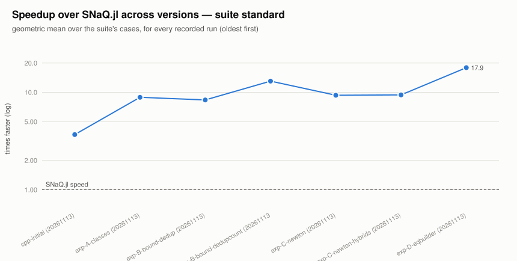
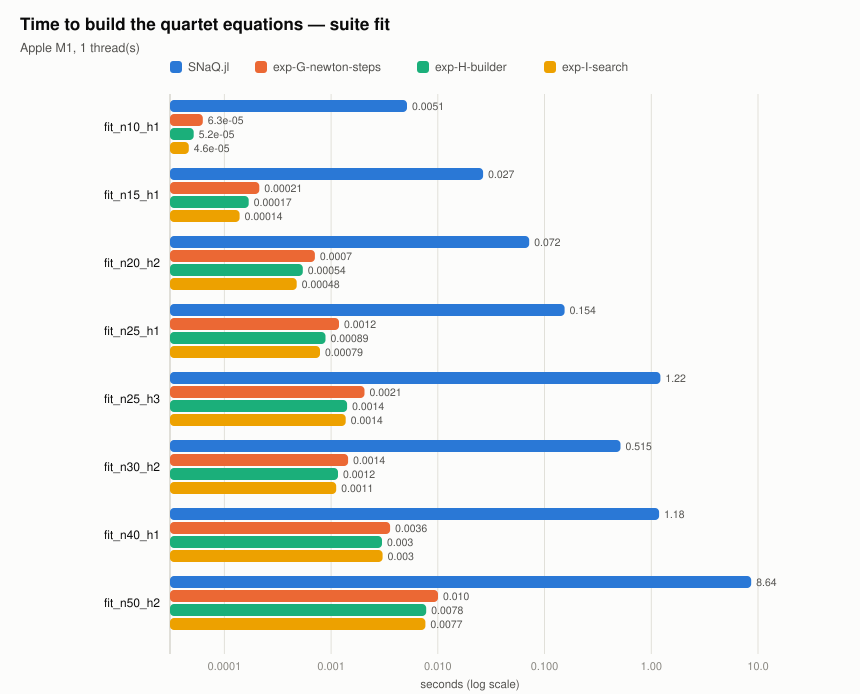

# CSNaQ benchmark report

Generated 2026-11-13T15:53:07-06:00 by `benchmarks/bench.py report` from `benchmarks/history/results.jsonl`. Baseline: **SNaQ.jl**.

Time is the wall time of the whole `snaq` process for C++. For SNaQ.jl it is the time to build the DataCF plus the `snaq!` call, after a warm-up call, so Julia's start-up and compilation are not included. Peak memory is the peak resident set size of the process; for SNaQ.jl it includes the Julia runtime and loaded packages (see `base_rss_mb` in the history). HWCD is the hardwired cluster distance between the best network and the true network (0: same topology). The score on all quartets is the SNaQ score of the best network recomputed by `csnaq_eval` on the observed CFs of all quartets, which makes runs that used `propQuartets` < 1 comparable. "Refitted to all quartets" is the score of the best network's topology after its parameters are fitted to all quartets, as is done for the true network: it compares topologies, whatever quartets the reported parameters were estimated from. After `bench.py rescore`, HWCD and the scores on all quartets of every version come from the same `csnaq_eval`.

## Suite `standard`

End-to-end snaq runs on simulated data from 10 to 50 taxa and 1 to 3 reticulations, 100 runs each. Each case uses about 1000 quartets: propQuartets = propQuartetsFinal = min(1, 1000 / binomial(ntaxa, 4)). Cases with 20 or more taxa use --lazy (observed CFs computed on demand).

Latest run of each version: **SNaQ.jl**: run `20261113T141603_SNaQ.jl`, **cpp-initial**: run `20261113T141602_cpp-initial`, **exp-A-classes**: run `20261113T151416_exp-A-classes`, **exp-B-bound-dedupcount**: run `20261113T152735_exp-B-bound-dedupcount`, **exp-B-bound-dedup**: run `20261113T152003_exp-B-bound-dedup`, **exp-C-newton**: run `20261113T153817_exp-C-newton`, **exp-C-newton-hybrids**: run `20261113T154448_exp-C-newton-hybrids`.

| case | version | time (s) | peak MB | best score | median run score | score on all quartets | refitted to all quartets | truth score on all quartets | HWCD | hybrids |
|---|---|---|---|---|---|---|---|---|---|---|
| n10_h1 | SNaQ.jl | 24.9132 | 1143.64 | -0.223569 | -0.270387 | -0.233167 | -0.226623 | -0.22524 | 4 | 1 |
| n10_h1 | cpp-initial | 4.99471 | 7.79688 | -0.225435 | -0.505173 | -0.225435 | -0.22524 | -0.22524 | 0 | 1 |
| n10_h1 | exp-A-classes | 2.09471 | 8.25 | -0.225435 | -0.507831 | -0.225435 | -0.22524 | -0.22524 | 0 | 1 |
| n10_h1 | exp-B-bound-dedupcount | 0.630356 | 8.21875 | -0.225435 | -0.508317 | -0.225435 | -0.22524 | -0.22524 | 0 | 1 |
| n10_h1 | exp-B-bound-dedup | 1.00733 | 8.51562 | -0.225435 | -0.227186 | -0.225435 | -0.22524 | -0.22524 | 0 | 1 |
| n10_h1 | exp-C-newton | 0.933821 | 8.53125 | -0.22524 | -0.22673 | -0.22524 | -0.22524 | -0.22524 | 0 | 1 |
| n10_h1 | exp-C-newton-hybrids | 0.739359 | 8.73438 | -0.22524 | -0.22673 | -0.22524 | -0.22524 | -0.22524 | 0 | 1 |
| n15_h1 | SNaQ.jl | 208.937 | 1090.34 | -1.43115 | -3.4746 | -1.98535 | -1.9832 | -2.20124 | 6 | 1 |
| n15_h1 | cpp-initial | 57.5226 | 9.42188 | -1.40385 | -3.37415 | -1.98527 | -1.9832 | -2.20124 | 6 | 1 |
| n15_h1 | exp-A-classes | 12.1351 | 9.34375 | -1.40385 | -3.37418 | -1.98527 | -1.9832 | -2.20124 | 6 | 1 |
| n15_h1 | exp-B-bound-dedupcount | 7.34241 | 9.625 | -1.40324 | -3.37222 | -1.98649 | -1.9832 | -2.20124 | 6 | 1 |
| n15_h1 | exp-B-bound-dedup | 12.574 | 9.57812 | -1.40228 | -3.072 | -1.98574 | -1.9832 | -2.20124 | 6 | 1 |
| n15_h1 | exp-C-newton | 10.1716 | 9.46875 | -1.40239 | -3.09541 | -1.98648 | -1.9832 | -2.20124 | 6 | 1 |
| n15_h1 | exp-C-newton-hybrids | 10.5675 | 9.17188 | -1.40252 | -2.68042 | -1.98414 | -1.9832 | -2.20124 | 6 | 1 |
| n20_h2 | SNaQ.jl | 180.818 | 1081.59 | -1.21354 | -7.81406 | -6.37721 | -6.32935 | -6.55637 | 12 | 2 |
| n20_h2 | cpp-initial | 58.1737 | 14.1406 | -1.21429 | -1.61421 | -6.35723 | -6.3215 | -6.55637 | 10 | 2 |
| n20_h2 | exp-A-classes | 23.7102 | 13.4219 | -1.21429 | -1.55557 | -6.35723 | -6.3215 | -6.55637 | 10 | 2 |
| n20_h2 | exp-B-bound-dedupcount | 16.5809 | 13.2188 | -1.21429 | -1.60207 | -6.35723 | -6.3215 | -6.55637 | 10 | 2 |
| n20_h2 | exp-B-bound-dedup | 23.494 | 13.9062 | -1.21429 | -1.40507 | -6.35723 | -6.3215 | -6.55637 | 10 | 2 |
| n20_h2 | exp-C-newton | 22.0962 | 13.9531 | -1.24589 | -1.40744 | -6.4881 | -6.46009 | -6.55637 | 10 | 2 |
| n20_h2 | exp-C-newton-hybrids | 23.6029 | 13.9844 | -1.21689 | -1.3512 | -6.36573 | -6.33145 | -6.55637 | 10 | 2 |
| n25_h1 | SNaQ.jl | 186.532 | 1184.95 | -1.38173 | -1.56734 | -19.4624 | -19.2281 | -20.1041 | 20 | 1 |
| n25_h1 | cpp-initial | 46.9776 | 13.7656 | -1.33902 | -1.53483 | -18.9504 | -18.7445 | -20.1041 | 20 | 1 |
| n25_h1 | exp-A-classes | 27.0625 | 13.3438 | -1.33902 | -1.53483 | -18.9504 | -18.7445 | -20.1041 | 20 | 1 |
| n25_h1 | exp-B-bound-dedupcount | 19.4165 | 13.4844 | -1.33663 | -1.53107 | -18.1872 | -17.9694 | -20.1041 | 18 | 1 |
| n25_h1 | exp-B-bound-dedup | 29.9429 | 13.2656 | -1.3347 | -1.50292 | -18.9235 | -18.694 | -20.1041 | 20 | 1 |
| n25_h1 | exp-C-newton | 31.5951 | 13.8281 | -1.34231 | -1.5081 | -18.2185 | -18.088 | -20.1041 | 20 | 1 |
| n25_h1 | exp-C-newton-hybrids | 30.5803 | 13.625 | -1.35522 | -1.5034 | -18.1914 | -18.1192 | -20.1041 | 22 | 1 |
| n25_h3 | SNaQ.jl | 1166.13 | 968.203 | -1.57573 | -4.62509 | -21.6193 | -21.2298 | -20.1142 | 20 | 3 |
| n25_h3 | cpp-initial | 315.669 | 14.7344 | -1.69717 | -4.62527 | -23.2311 | -22.9275 | -20.1142 | 22 | 3 |
| n25_h3 | exp-A-classes | 153.412 | 15.1562 | -1.57845 | -4.1962 | -20.8004 | -20.5933 | -20.1142 | 20 | 3 |
| n25_h3 | exp-B-bound-dedupcount | 132.365 | 14.3281 | -1.58116 | -4.14003 | -21.219 | -20.9471 | -20.1142 | 22 | 3 |
| n25_h3 | exp-B-bound-dedup | 228.292 | 14.5156 | -1.58116 | -3.33681 | -21.219 | -20.9471 | -20.1142 | 22 | 3 |
| n25_h3 | exp-C-newton | 189.585 | 14.4062 | -1.48677 | -3.45363 | -20.0842 | -19.8409 | -20.1142 | 10 | 3 |
| n25_h3 | exp-C-newton-hybrids | 192.423 | 15.6719 | -1.56264 | -3.26133 | -20.753 | -20.5659 | -20.1142 | 12 | 3 |
| n30_h2 | SNaQ.jl | 312.185 | 966.828 | -1.64993 | -2.28227 | -49.1109 | -48.5461 | -48.9468 | 8 | 2 |
| n30_h2 | cpp-initial | 94.2205 | 14.5156 | -1.61082 | -2.26752 | -48.8006 | -48.2388 | -48.9468 | 10 | 2 |
| n30_h2 | exp-A-classes | 38.7337 | 13.875 | -1.61075 | -2.27922 | -48.803 | -48.2388 | -48.9468 | 10 | 2 |
| n30_h2 | exp-B-bound-dedupcount | 34.9092 | 14.2969 | -1.64602 | -2.4106 | -47.3012 | -46.6487 | -48.9468 | 18 | 2 |
| n30_h2 | exp-B-bound-dedup | 54.9828 | 14.2344 | -1.57731 | -1.85988 | -48.3586 | -47.8574 | -48.9468 | 24 | 2 |
| n30_h2 | exp-C-newton | 52.3083 | 14.7656 | -1.5993 | -1.86896 | -46.358 | -45.7432 | -48.9468 | 16 | 2 |
| n30_h2 | exp-C-newton-hybrids | 50.2599 | 14.9375 | -1.56359 | -1.8014 | -47.1689 | -46.7394 | -48.9468 | 12 | 2 |
| n40_h1 | SNaQ.jl | 210.55 | 1209.11 | -0.826667 | -1.09699 | -83.5046 | -82.0908 | -81.2316 | 2 | 1 |
| n40_h1 | cpp-initial | 54.6406 | 33.7031 | -0.82739 | -1.10368 | -81.9216 | -80.1137 | -81.2316 | 14 | 1 |
| n40_h1 | exp-A-classes | 26.0829 | 33.5156 | -0.82739 | -1.09899 | -81.9215 | -80.1137 | -81.2316 | 14 | 1 |
| n40_h1 | exp-B-bound-dedupcount | 18.2478 | 33.5938 | -0.82739 | -1.09645 | -81.9215 | -80.1137 | -81.2316 | 14 | 1 |
| n40_h1 | exp-B-bound-dedup | 28.7424 | 34.4062 | -0.821078 | -1.07642 | -82.0523 | -80.2017 | -81.2316 | 22 | 1 |
| n40_h1 | exp-C-newton | 24.2371 | 34.4531 | -0.821061 | -1.07701 | -81.7989 | -80.2382 | -81.2316 | 22 | 1 |
| n40_h1 | exp-C-newton-hybrids | 26.4365 | 33.7969 | -0.823797 | -1.08055 | -81.5232 | -80.4679 | -81.2316 | 18 | 1 |
| n50_h2 | SNaQ.jl | 389.614 | 1131.92 | -1.15819 | -18.212 | -266.663 | -256.563 | -197.667 | 14 | 2 |
| n50_h2 | cpp-initial | 121.3 | 36.7812 | -0.928489 | -14.2381 | -223.033 | -214.433 | -197.667 | 14 | 2 |
| n50_h2 | exp-A-classes | 53.2259 | 36.7969 | -0.906863 | -14.1441 | -215.811 | -211.755 | -197.667 | 22 | 2 |
| n50_h2 | exp-B-bound-dedupcount | 49.9201 | 36.0469 | -0.906863 | -13.0814 | -215.811 | -211.755 | -197.667 | 22 | 2 |
| n50_h2 | exp-B-bound-dedup | 69.1985 | 36.0312 | -0.828031 | -8.26142 | -203.479 | -200.158 | -197.667 | 18 | 2 |
| n50_h2 | exp-C-newton | 56.9988 | 36.5 | -0.830043 | -8.44807 | -203.798 | -200.408 | -197.667 | 10 | 2 |
| n50_h2 | exp-C-newton-hybrids | 59.1139 | 36.5156 | -0.844858 | -7.23005 | -207.139 | -202.111 | -197.667 | 16 | 2 |

## Suite `fit`

Numerical parameter optimization of a fixed network (the true network) on the observed CFs of all quartets: fitnumericalparameters! with maxeval = 1000.

Latest run of each version: **SNaQ.jl**: run `20261113T150153_SNaQ.jl`, **cpp-initial**: run `20261113T142841_cpp-initial`, **exp-A-classes**: run `20261113T151955_exp-A-classes`, **exp-C-newton-hybrids**: run `20261113T155124_exp-C-newton-hybrids`.

| case | version | fit (s) | equations (s) | peak MB | score | quartets | parameters |
|---|---|---|---|---|---|---|---|
| fit_n10_h1 | SNaQ.jl | 0.00596933 | 0.00514454 | 692.875 | -0.22524 | 210 | 11 |
| fit_n10_h1 | cpp-initial | 0.000929708 | 0.00108238 | 6.17188 | -0.22524 | 210 | 11 |
| fit_n10_h1 | exp-A-classes | 0.000572125 | 0.000295208 | 6.23438 | -0.22524 | 210 | 11 |
| fit_n10_h1 | exp-C-newton-hybrids | 0.000586875 | 0.000292666 | 6.29688 | -0.22524 | 210 | 11 |
| fit_n15_h1 | SNaQ.jl | 0.0775856 | 0.0265386 | 715.984 | -2.20124 | 1365 | 16 |
| fit_n15_h1 | cpp-initial | 0.00147729 | 0.00509496 | 7.01562 | -2.20124 | 1365 | 16 |
| fit_n15_h1 | exp-A-classes | 0.000678875 | 0.0007845 | 6.6875 | -2.20124 | 1365 | 16 |
| fit_n15_h1 | exp-C-newton-hybrids | 0.0004865 | 0.000832958 | 6.6875 | -2.20124 | 1365 | 16 |
| fit_n20_h2 | SNaQ.jl | 0.290687 | 0.0717673 | 749.812 | -6.55637 | 4845 | 23 |
| fit_n20_h2 | cpp-initial | 0.00610704 | 0.0119775 | 11.6406 | -6.55637 | 4845 | 23 |
| fit_n20_h2 | exp-A-classes | 0.00387 | 0.00274704 | 10.2344 | -6.55637 | 4845 | 23 |
| fit_n20_h2 | exp-C-newton-hybrids | 0.00105467 | 0.00250167 | 10.3125 | -6.55637 | 4845 | 23 |
| fit_n25_h1 | SNaQ.jl | 0.776733 | 0.154207 | 711.922 | -20.1041 | 12650 | 24 |
| fit_n25_h1 | cpp-initial | 0.005442 | 0.0206196 | 14.1094 | -20.1041 | 12650 | 24 |
| fit_n25_h1 | exp-A-classes | 0.00852912 | 0.00354917 | 10.9219 | -20.1041 | 12650 | 24 |
| fit_n25_h1 | exp-C-newton-hybrids | 0.00140842 | 0.00363904 | 10.9375 | -20.1041 | 12650 | 24 |
| fit_n25_h3 | SNaQ.jl | 4.43912 | 1.21888 | 859.797 | -27.5921 | 12650 | 32 |
| fit_n25_h3 | cpp-initial | 0.0710932 | 0.182203 | 20.0156 | -27.5921 | 12650 | 32 |
| fit_n25_h3 | exp-A-classes | 0.0237497 | 0.0155119 | 11.5625 | -20.1142 | 12650 | 32 |
| fit_n25_h3 | exp-C-newton-hybrids | 0.00838388 | 0.016571 | 11.6719 | -20.1142 | 12650 | 32 |
| fit_n30_h2 | SNaQ.jl | 1.05106 | 0.51477 | 924.594 | -48.9468 | 27405 | 31 |
| fit_n30_h2 | cpp-initial | 0.00834229 | 0.066203 | 20.875 | -48.9468 | 27405 | 31 |
| fit_n30_h2 | exp-A-classes | 0.00426458 | 0.00480363 | 11.6406 | -48.9468 | 27405 | 31 |
| fit_n30_h2 | exp-C-newton-hybrids | 0.00257471 | 0.00436304 | 11.6406 | -48.9468 | 27405 | 31 |
| fit_n40_h1 | SNaQ.jl | 1.918 | 1.18424 | 1056.75 | -81.2316 | 91390 | 39 |
| fit_n40_h1 | cpp-initial | 0.0138845 | 0.116986 | 63.8594 | -81.2316 | 91390 | 39 |
| fit_n40_h1 | exp-A-classes | 0.0112363 | 0.00799783 | 35.4688 | -81.2316 | 91390 | 39 |
| fit_n40_h1 | exp-C-newton-hybrids | 0.0141902 | 0.00759613 | 35.6719 | -81.2316 | 91390 | 39 |
| fit_n50_h2 | SNaQ.jl | 27.366 | 8.6391 | 1184.75 | -197.667 | 230300 | 53 |
| fit_n50_h2 | cpp-initial | 0.099225 | 0.763607 | 122.969 | -197.667 | 230300 | 53 |
| fit_n50_h2 | exp-A-classes | 0.065732 | 0.0309066 | 43.875 | -197.667 | 230300 | 53 |
| fit_n50_h2 | exp-C-newton-hybrids | 0.0242798 | 0.0320116 | 44 | -197.667 | 230300 | 53 |

